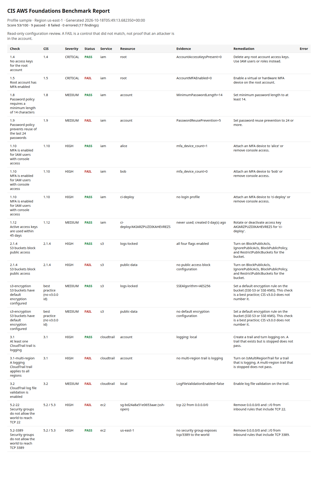
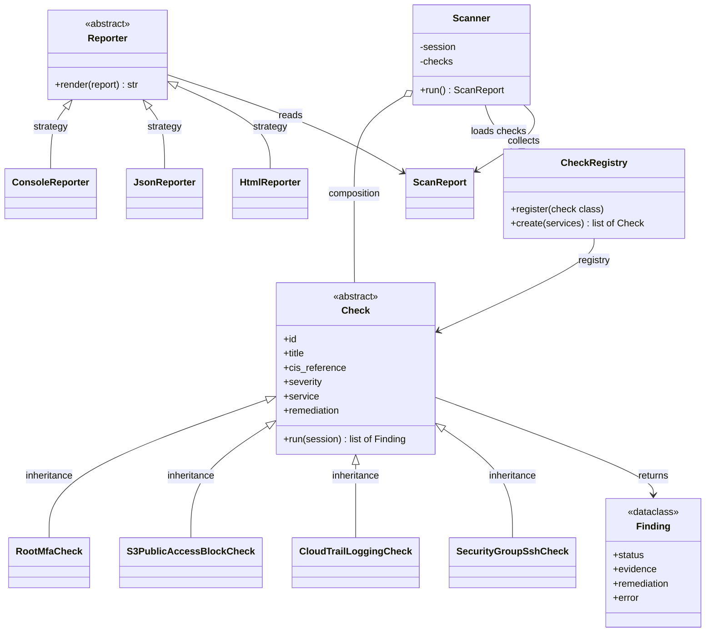

# CIS AWS Foundations Benchmark Scanner

[](https://github.com/CarlosDiegoBaes/cis-aws-scanner/actions/workflows/tests.yml)
[](LICENSE)
[](requirements.txt)

A small, read-only scanner that compares an AWS account with a subset of
the **CIS AWS Foundations Benchmark v3.0.0** and prints a scored report.

Cloud accounts drift. Root MFA gets turned off, a bucket is created
without Block Public Access, a security group is opened to the world
"just for the lab." This project is the blue-team habit of checking
those settings on purpose: call the AWS APIs, compare them with a
written control, and say what to fix. It does not change the account.

It is also a practice project for object-oriented Python. The classes
are small, the names match the job, and the tests run against
[moto](https://github.com/getmoto/moto) so you do not need a real AWS
account.

## Sample output

`generate_sample_output.py` builds a mocked account that is only partly
compliant, then runs the scanner. The console report from that run:

```text
CIS AWS Foundations Benchmark scan
Profile: sample    Region: us-east-1
Generated: 2026-10-18T05:49:13.682350+00:00

[PASS ] 1.4              CRITICAL iam         No access keys for the root account
[FAIL ] 1.5              CRITICAL iam         Root account has MFA enabled
        resource: root
        evidence: AccountMFAEnabled=0
        fix: Enable a virtual or hardware MFA device on the root account.
[PASS ] 1.8              MEDIUM   iam         Password policy requires a minimum length of 14 characters
[FAIL ] 1.9              MEDIUM   iam         Password policy prevents reuse of the last 24 passwords
        resource: account
        evidence: PasswordReusePrevention=5
        fix: Set password reuse prevention to 24 or more.
[PASS ] 1.10             HIGH     iam         MFA is enabled for IAM users with console access
[FAIL ] 1.10             HIGH     iam         MFA is enabled for IAM users with console access
        resource: bob
        evidence: mfa_device_count=0
        fix: Attach an MFA device to 'bob' or remove console access.
[PASS ] 1.10             HIGH     iam         MFA is enabled for IAM users with console access
[PASS ] 1.12             MEDIUM   iam         Active access keys are used within 45 days
[PASS ] 2.1.4            HIGH     s3          S3 buckets block public access
[FAIL ] 2.1.4            HIGH     s3          S3 buckets block public access
        resource: public-data
        evidence: no public access block configuration
        fix: Turn on BlockPublicAcls, IgnorePublicAcls, BlockPublicPolicy, and RestrictPublicBuckets for the bucket.
[PASS ] s3-encryption    MEDIUM   s3          S3 buckets have default encryption configured
[FAIL ] s3-encryption    MEDIUM   s3          S3 buckets have default encryption configured
        resource: public-data
        evidence: no default encryption configuration
        fix: Set a default encryption rule on the bucket (SSE-S3 or SSE-KMS). This check is a best practice; CIS v3.0.0 does not number it.
[PASS ] 3.1              HIGH     cloudtrail  At least one CloudTrail trail is logging
[FAIL ] 3.1-multi-region HIGH     cloudtrail  A logging CloudTrail trail applies to all regions
        resource: account
        evidence: no multi-region trail is logging
        fix: Turn on IsMultiRegionTrail for a trail that is logging. A multi-region trail that is stopped does not pass.
[FAIL ] 3.2              MEDIUM   cloudtrail  CloudTrail log file validation is enabled
        resource: local
        evidence: LogFileValidationEnabled=false
        fix: Enable log file validation on the trail.
[FAIL ] 5.2-22           HIGH     ec2         Security groups do not allow the world to reach TCP 22
        resource: sg-bd24a8a51e0653aae (ssh-open)
        evidence: tcp 22 from 0.0.0.0/0
        fix: Remove 0.0.0.0/0 and ::/0 from inbound rules that include TCP 22.
[PASS ] 5.2-3389         HIGH     ec2         Security groups do not allow the world to reach TCP 3389

Score: 53/100    9 passed, 8 failed, 0 errored (17 findings)
By severity: CRITICAL 1 pass / 1 fail / 0 error; HIGH 5 pass / 4 fail / 0 error; MEDIUM 3 pass / 3 fail / 0 error
```

The same run is checked in as JSON and HTML:

- [sample_output/report.json](sample_output/report.json)
- [sample_output/report.html](sample_output/report.html)



Regenerate it with `python generate_sample_output.py`. The security
group id in the sample changes between moto versions. The pass/fail
mix does not.

## Architecture



The words on the arrows are the OOP ideas this project is practicing:

- **Abstraction.** `Check` and `Reporter` say what every control and
  every report can do. They do not say how IAM or HTML works.
- **Inheritance.** `RootMfaCheck` is a `Check`. It fills in `run()` and
  reuses `finding()` to build the result.
- **Polymorphism.** `Scanner` calls `check.run(session)` and does not
  care which subclass it has. The CLI calls `reporter.render(report)`
  the same way for console, JSON, and HTML.
- **Composition.** `Scanner` *has* a boto3 session and a list of
  checks. It is not a subclass of either one.
- **Registry.** Each check class signs up with `@registry.register`
  when its module is imported. `load_checks()` imports those modules.
  The scanner asks the registry for instances instead of keeping a
  hand-written list.
- **Strategy.** `ConsoleReporter`, `JsonReporter`, and `HtmlReporter`
  are three ways to present one `ScanReport`. The caller picks one.

`Finding`, `ScoreSummary`, and `ScanReport` are dataclasses. A finding
keeps `remediation` (how to fix it) separate from `error` (the
exception text, and only when the status is `ERROR`). `evidence` is the
raw value behind a pass or fail, such as `MinimumPasswordLength=8`.

The score starts from severity weights: CRITICAL 4, HIGH 3, MEDIUM 2,
LOW 1. It is the percentage of that weight which passed, rounded to an
integer. `ERROR` findings are counted and then left out of the
percentage, because the scanner could not judge them. These weights are
this project's triage labels. CIS publishes the control text, not these
four buckets.

## Controls

Pinned to CIS AWS Foundations Benchmark **v3.0.0 (2024-01-31)** unless
the CIS column says otherwise. CIS renumbers this benchmark between
versions. Re-check every id before you target a different edition.
The mapping below follows the control titles AWS Security Hub documents
for v3.0.0.

| Check | CIS | What it looks at | Severity |
|---|---|---|---|
| 1.4 | 1.4 | No root account access keys | CRITICAL |
| 1.5 | 1.5 | Root account MFA is enabled | CRITICAL |
| 1.8 | 1.8 | Password policy minimum length is at least 14 | MEDIUM |
| 1.9 | 1.9 | Password policy remembers at least 24 passwords | MEDIUM |
| 1.10 | 1.10 | IAM users with a console password have MFA | HIGH |
| 1.12 | 1.12 | Active access keys unused for 45 days or more | MEDIUM |
| 2.1.4 | 2.1.4 | Each S3 bucket has all four Block Public Access flags | HIGH |
| s3-encryption | best practice, no v3.0.0 id | Each bucket has an explicit default encryption rule | MEDIUM |
| 3.1 | 3.1 | At least one CloudTrail trail is logging | HIGH |
| 3.1-multi-region | 3.1 | A trail that is logging is multi-region | HIGH |
| 3.2 | 3.2 | Every trail has log file validation | MEDIUM |
| 5.2-22 | 5.2 / 5.3 | No security group lets the world reach TCP 22 | HIGH |
| 5.2-3389 | 5.2 / 5.3 | No security group lets the world reach TCP 3389 | HIGH |

CIS 3.1 is one sentence: CloudTrail is enabled in all regions. This
scanner splits that sentence into two classes so each class has one
job. Both still cite 3.1.

CIS 5.2 (IPv4) and 5.3 (IPv6) cover remote admin ports together. The
two security-group classes split that by port, and each one flags both
`0.0.0.0/0` and `::/0`. A rule matches when it is TCP on that port, a
port range that includes it, or protocol `-1` (all traffic).

A few real v3.0.0 controls are left out on purpose:

- Password composition rules and a maximum password age. Older
  benchmarks had them. v3.0.0 dropped them, in line with NIST 800-63B.
- 1.6 hardware MFA for root, 1.7 root usage, 1.11 keys created with
  the user, 1.13 one active key per user, and 1.14 rotation every 90
  days. 1.14 is a different check from 1.12: 1.12 is about keys sitting
  unused, 1.14 is about rotating keys on a schedule while they are
  still used.
- S3 TLS-only bucket policies (2.1.1), MFA delete (2.1.2), account-level
  Block Public Access, CloudTrail log-bucket logging (3.4), and the
  rest of the benchmark.

### Access key age (1.12)

Only `Active` keys are judged. An `Inactive` key is already disabled,
so it produces no finding. A key that has never been used is judged by
`CreateDate`, not failed automatically: a key created five minutes ago
has not had a chance to be used. Age is whole days. 44 days passes.
45 days fails, because the control says 45 days or greater.

## Install

Python 3.11 or newer.

```bash
python -m venv .venv
source .venv/bin/activate        # Windows: .venv\Scripts\activate
pip install -r requirements-dev.txt
```

`requirements.txt` pins boto3. `requirements-dev.txt` pins moto, pytest,
and ruff. Direct dependencies use `==` so a later release does not
change the tests underneath you.

## Usage

Use a read-only principal. For this subset, that is the IAM, S3,
CloudTrail, and EC2 read calls listed below. The AWS managed policy
`SecurityAudit` covers them and is broader than this scanner needs.

```bash
python -m cis_aws_scanner --profile lab --region us-east-1
python -m cis_aws_scanner --service iam --format json
python -m cis_aws_scanner --service iam,s3 --format html --output report.html
```

`python -m cis_aws_scanner.scanner` calls the same entry point.

| Flag | Meaning |
|---|---|
| `--profile` | AWS CLI profile. Omit it to use the normal credential chain. |
| `--region` | Region for S3, CloudTrail, and EC2. Default `us-east-1`. IAM is global. |
| `--format` | `console` (default), `json`, or `html`. Printed to stdout. |
| `--service` | `iam`, `s3`, `cloudtrail`, or `ec2`. Repeat the flag, or pass a comma-separated list. Omit it to run every check. |
| `--output` | Also write the report to this path. The "wrote file" line goes to stderr so it does not break a JSON pipe. |

The process exits 0 after a scan, including when controls fail. A bad
`--service` name exits with argparse's usage error. A missing
permission becomes an `ERROR` finding for that check. The other checks
still run.

API calls the checks make:

- IAM: `GetAccountSummary`, `GetAccountPasswordPolicy`, `ListUsers`,
  `GetLoginProfile`, `ListMFADevices`, `ListAccessKeys`,
  `GetAccessKeyLastUsed`
- S3: `ListBuckets`, `GetBucketLocation`, `GetPublicAccessBlock`,
  `GetBucketEncryption`
- CloudTrail: `DescribeTrails`, `GetTrailStatus`
- EC2: `DescribeSecurityGroups`

## Tests

```bash
pytest
ruff check .
ruff format --check .
```

GitHub Actions runs those three commands on Python 3.11 and 3.12 for
pushes to `main` and for pull requests. The tests set dummy AWS
environment variables and mock the API with moto. A few IAM cases use
`unittest.mock` because moto cannot backdate an access key to an exact
day. No test needs a network or a real account.

## Project layout

```text
cis_aws_scanner/
  check.py            Check base class (abc)
  registry.py         CheckRegistry and load_checks()
  scanner.py          Scanner: one session, many checks
  scoring.py          Severity-weighted score
  models.py           Status, Severity, Finding, ScanReport
  cli.py              argparse entry point
  __main__.py         python -m cis_aws_scanner
  checks/
    iam.py            Section 1
    s3.py             Block Public Access and default encryption
    cloudtrail.py     Logging, multi-region, log validation
    ec2.py            TCP 22 and TCP 3389 open to the world
  reporters/
    base.py           Reporter base class
    console.py
    json_reporter.py
    html_reporter.py
tests/                pytest, one module per area
generate_sample_output.py
.github/workflows/tests.yml
```

## Adding a check

1. Subclass `Check` in the service module. Set `id`, `title`,
   `cis_reference`, `severity`, `service`, and `remediation`.
2. Implement `run(self, session)`. Return one `Finding` per resource.
   Catch `ClientError` and return an `ERROR` finding. Leave
   `remediation` as the fix-it text.
3. Decorate the class with `@registry.register`.
4. Import the class from `cis_aws_scanner/checks/__init__.py` so
   `load_checks()` sees it.
5. Add a passing test and a failing test under `tests/`.

`run()` returns a list because one control often applies to many
resources (every user, every bucket, every security group). An
account-level control returns a one-item list.

## Limitations

- This is a subset of one benchmark, for one account, in one region.
  It is a study project, not a compliance attestation.
- Regional checks use the session region. A single-region CloudTrail
  whose home is another region does not appear. Multi-region trails do.
- S3 calls are sent to each bucket's own region, but the scanner does
  not walk every region for EC2 or CloudTrail.
- `s3-encryption` looks for an explicit bucket encryption
  configuration. Amazon S3 applies SSE-S3 by default even when that
  configuration is missing, which is why v3.0.0 has no control number
  for it. A FAIL here can still be an encrypted bucket.
- Block Public Access is checked per bucket (CIS 2.1.4). The separate
  account-level setting is not queried.
- Security group checks cover TCP 22 and TCP 3389, including ranges and
  all-protocol rules that include those ports. They do not list every
  other port a reader might treat as administrative.
- The scanner does not read CloudTrail event selectors, so it cannot
  tell whether a trail records management events.
- The HTML report escapes AWS-provided strings before inserting them.
  It is a static file, not an authenticated dashboard.
- The score is a teaching aid. A 100 does not mean the account meets
  the full CIS benchmark.
- moto's account summary always reports root MFA as disabled and root
  access keys as absent. The passing root-MFA path and the failing
  root-key path are covered with a fake IAM client.
- Nothing in the scanner creates, deletes, or modifies AWS resources.
  The sample generator does, and only inside moto.
